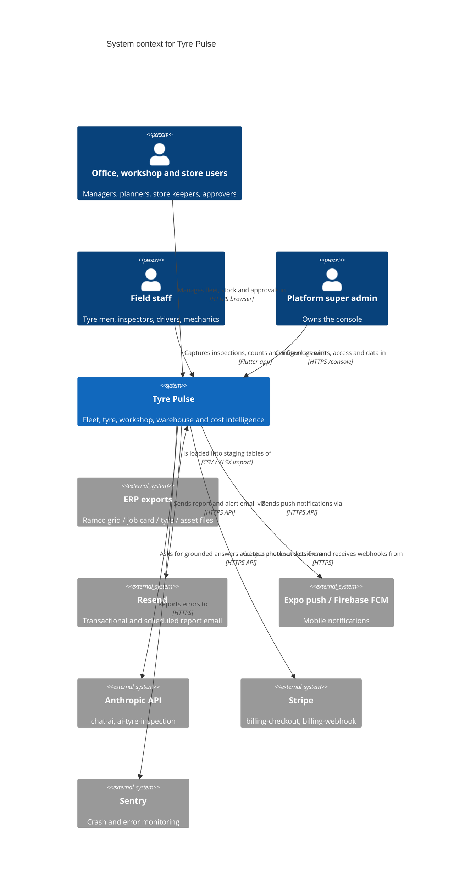
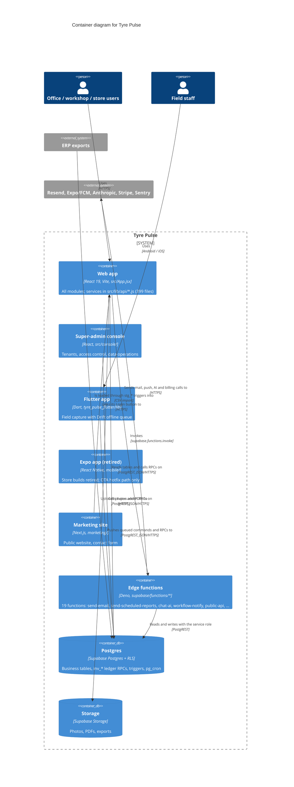
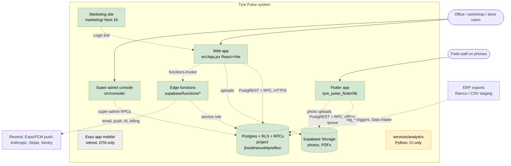

# 01 · System context and containers (C4 levels 1 and 2)

Analysed: worktree `claude/wms-wp0-register` (tip `89cf96c3`) and the live database `jhssdmeruxtrlqnwfksc`, 2026-11-24.

**Legend:** green = IMPLEMENTED (live in DB and wired in code) · yellow = PARTIAL (built but unused, empty, or degrades to "not provisioned") · red = BROKEN (evidence below) · purple dashed = PROPOSED (migration file marked `STATUS: NOT APPLIED`, absent from `supabase_migrations.schema_migrations`) · dashed arrow = text join with no FK, or a proposed link. Row counts are exact `count(*)` reads on 2026-11-24.

## Level 1 — System context

## Level 2 — Containers

## Same view as an editable draw.io diagram

Source: `diagrams/01-system-container/01-system-container.mmd` → `.drawio`.

## Elements

| Name | Type | Technology | Status | Evidence |
|---|---|---|---|---|
| Web app | Container | React + Vite | IMPLEMENTED | `src/App.jsx` routes, `src/lib/api/_client.js` |
| Console | Container | React | IMPLEMENTED | `src/console/` |
| Flutter app | Container | Flutter + Drift | IMPLEMENTED | `tyre_pulse_flutter/lib/core/sync/sync_engine.dart` |
| Expo app | Container | React Native | RETIRED | PROJECT_MEMORY: store builds retired, OTA hotfix only |
| Marketing | Container | Next.js | IMPLEMENTED | `marketing/` (separate Vercel project) |
| Edge functions | Container | Deno | IMPLEMENTED | `supabase/functions/` (19 dirs) |
| services/analytics | Library | Python | PARTIAL | Run by CI only; not called by the app |
| Postgres | Database | Supabase | IMPLEMENTED | 30 migrations applied since 2026-11-20; 7 newer files NOT APPLIED |

## Assumptions
- External systems are listed from `supabase/functions/*` and PROJECT_MEMORY; their live configuration (keys set or not) was not read.
