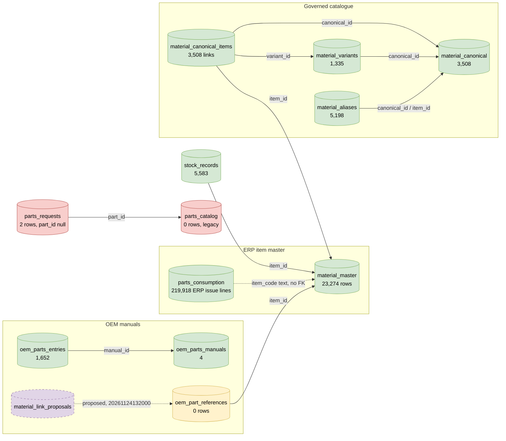

# 02 · Material Master and OEM relationships

**Legend:** green = IMPLEMENTED (live in DB and wired in code) · yellow = PARTIAL (built but unused, empty, or degrades to "not provisioned") · red = BROKEN (evidence below) · purple dashed = PROPOSED (migration file marked `STATUS: NOT APPLIED`, absent from `supabase_migrations.schema_migrations`) · dashed arrow = text join with no FK, or a proposed link. Row counts are exact `count(*)` reads on 2026-11-24.

Editable: `diagrams/02-material-oem/02-material-oem.drawio`.

| Edge | Real constraint | Note |
|---|---|---|
| material_canonical_items → material_master | `material_canonical_items_item_id_fkey` | 3,508 links, filled by `20261123200000_wms_wp1_links_oem_norm_brand_aliases.sql` (applied as `20261123185906`) |
| material_canonical_items → material_canonical / material_variants | `..._canonical_id_fkey`, `..._variant_id_fkey` | live |
| material_aliases → material_canonical / material_master | `material_aliases_canonical_id_fkey`, `material_aliases_item_id_fkey` | 5,198 aliases |
| stock_records → material_master | `stock_records_item_id_fkey` | 5,583 rows |
| parts_consumption → material_master | none (text `item_code`) | 219,918 ERP lines joined by code only |
| oem_parts_entries → oem_parts_manuals | `oem_parts_entries_manual_id_fkey` | 1,652 entries from 4 manuals |
| oem_part_references → material_master | `oem_part_references_item_id_fkey` | **0 rows** — PARTIAL |
| material_link_proposals | — | PROPOSED in `20261124132000_wms_oem_material_link_reconcile.sql` (`inv_material_link_propose/decide/candidates/health`). `src/lib/api/materialLinks.js` already calls `inv_material_link_candidates`, which does not exist live |
| parts_requests → parts_catalog | `parts_requests_part_id_fkey` | **BROKEN:** `parts_catalog` has 0 rows, both `parts_requests` rows have `part_id` null; `src/lib/api/partsRequests.js` reads the empty catalogue |

Web surfaces: `src/components/inventory/MaterialMasterSection.jsx`, `OemCrossRefPanel.jsx`, `OemFitmentPanel.jsx`, `src/components/oem/*`; services `src/lib/api/materialMaster.js`, `physicalInventory.js` (`inv_material_canonical_*`, `inv_material_variant_*`, `inv_material_link_item`), `oemPartsCatalog.js`, `oemCatalogAdmin.js`.
