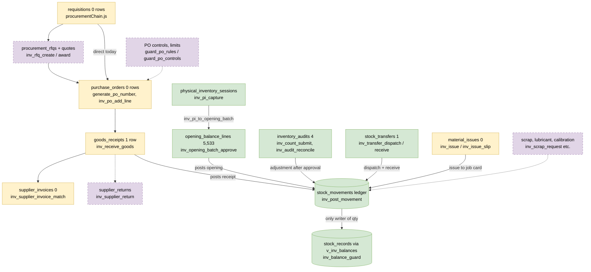

# 03 · Warehouse and procurement workflows

**Legend:** green = IMPLEMENTED (live in DB and wired in code) · yellow = PARTIAL (built but unused, empty, or degrades to "not provisioned") · red = BROKEN (evidence below) · purple dashed = PROPOSED (migration file marked `STATUS: NOT APPLIED`, absent from `supabase_migrations.schema_migrations`) · dashed arrow = text join with no FK, or a proposed link. Row counts are exact `count(*)` reads on 2026-11-24.

Editable: `diagrams/03-warehouse-procurement/03-warehouse-procurement.drawio`.

## The one rule that holds today
`stock_records` quantity can only change through a posted movement: trigger `trg_zz_inv_balance_guard` → `inv_balance_guard()` raises 42501 *"Stock quantity can only be set by a posted movement (inv_post_movement or an approved opening balance)"* unless `_inv_posting_on()`. `stock_movements` is append-only (`trg_inv_ledger_append_only` → `inv_ledger_guard`).

## Step status

| Step | Tables / RPCs | Rows | Status | Code |
|---|---|---:|---|---|
| Requisition | `requisitions` | 0 | PARTIAL (built, unused) | `src/lib/api/procurementChain.js` |
| RFQ / quotes | `procurement_rfqs`, `procurement_quotes`, `inv_rfq_*` | — | PROPOSED `20261124130000` | `src/lib/api/procurementDepth.js` returns `not_provisioned` |
| PO + controls | `purchase_orders`, `purchase_order_lines`, `generate_po_number`, `inv_po_add_line` | 0 / 0 | PARTIAL; guards `guard_po_rules`, `guard_po_delivery_status` PROPOSED `20261124090000` | `procurementChain.js`, `purchaseOrders.js` |
| Goods receipt | `goods_receipts`, `goods_receipt_lines`, `inv_receive_goods` | 1 / 0 | PARTIAL | `goodsReceipts.js`, `/goods-receipt` |
| Supplier invoice | `supplier_invoices`, `inv_supplier_invoice_create/match` | 0 | PARTIAL | `procurementDepth.js` |
| Supplier return | `supplier_returns`, `inv_supplier_return` | — | PROPOSED `20261124130000` | |
| Opening balance | `opening_balance_batches/lines`, `inv_opening_batch_*` | 5,533 lines | IMPLEMENTED | `OpeningBalancePanel.jsx` |
| Physical inventory | `physical_inventory_sessions`, `inv_pi_*` | 1 session | IMPLEMENTED | `physicalInventory.js`, Flutter `physical_capture_outbox.dart` |
| Cycle count / audit | `inventory_audits`, `inventory_count_lines`, `inv_count_submit`, `inv_audit_reconcile` | 4 audits | IMPLEMENTED | `AuditsSection.jsx` |
| Transfer | `stock_transfers`, `inv_transfer_dispatch/receive` | 1 | IMPLEMENTED (lightly used) | Flutter `inventory_transfer_repository.dart` |
| Issue to job card | `material_issues`, `inv_issue` (live), `inv_issue_slip` | 0 | PARTIAL; `inv_issue_slip` PROPOSED `20261124091000` | `materialIssue.js` |
| Scrap, lubricant, calibration, unit events | `inventory_scrap_requests`, `inventory_lubricant_dispenses`, `equipment_calibrations` | — | PROPOSED `20261124133000` | `src/lib/api/warehouseAssets.js`, `src/lib/warehouseClasses/specialClasses.js` |
| Ledger + balance | `stock_movements` → `stock_records` (`v_inv_balances`) | 5,619 / 5,583 | IMPLEMENTED | `inv_post_movement`, `post_stock_movement` |
