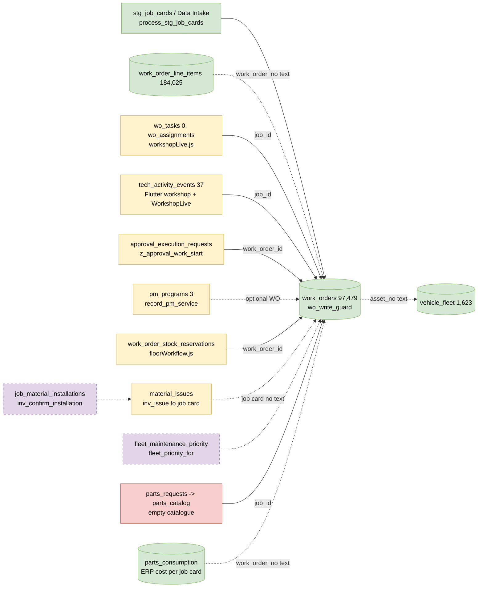

# 04 · Workshop and asset maintenance

**Legend:** green = IMPLEMENTED (live in DB and wired in code) · yellow = PARTIAL (built but unused, empty, or degrades to "not provisioned") · red = BROKEN (evidence below) · purple dashed = PROPOSED (migration file marked `STATUS: NOT APPLIED`, absent from `supabase_migrations.schema_migrations`) · dashed arrow = text join with no FK, or a proposed link. Row counts are exact `count(*)` reads on 2026-11-24.

Editable: `diagrams/04-workshop-maintenance/04-workshop-maintenance.drawio`.

| Element | Evidence | Status |
|---|---|---|
| `work_orders` 97,479 rows, guards `wo_write_guard`, `wo_delete_guard`, `trg_status_cap_work_orders`, `z_approval_work_start` | live triggers | IMPLEMENTED |
| `work_order_line_items` 184,025 | no FK to work_orders (text `work_order_no`) | IMPLEMENTED, text join |
| `work_orders.asset_no` → `vehicle_fleet` (1,623) | no FK; normalised by `trg_normalize_asset_no` | IMPLEMENTED, text join |
| `wo_tasks` (0) / `wo_assignments` / `tech_activity_events` (37) | FKs `wo_tasks_job_id_fkey`, `wo_assignments_job_id_fkey`, `tech_activity_events_job_id_fkey`; `src/lib/api/workshopLive.js`, Flutter `features/workshop` | PARTIAL (little data) |
| `pm_programs` (3) / `pm_service_records`, RPC `record_pm_service` | `pm_service_records_pm_program_id_fkey`; `src/pages/PmPrograms.jsx` | PARTIAL |
| `approval_execution_requests` | `..._work_order_id_fkey`, `..._vehicle_id_fkey`; 0 rows | PARTIAL |
| `work_order_stock_reservations` | `..._work_order_id_fkey`; 0 rows; `src/lib/api/floorWorkflow.js` | PARTIAL |
| `material_issues` → job card | no FK, `inv_issue` live; `src/lib/workshopStock/service.js` | PARTIAL |
| `job_material_installations`, `inv_confirm_installation` | `20261124131000_wms_workshop_job_materials.sql`; `workshopStock/service.js` degrades to `not_provisioned` | PROPOSED |
| `fleet_priority_for`, `fleet_maintenance_priority_tg` | `20261124120000_fleet_maintenance_priority.sql` | PROPOSED |
| `parts_requests` → `parts_catalog` | `parts_requests_part_id_fkey`; catalogue 0 rows | BROKEN |
| `parts_consumption` (ERP cost per job card) | text `work_order_no`; classifier `classify_parts_consumption` | IMPLEMENTED |

Web: `/work-orders`, `/workshop-live`, `/workshop/:jobId`, `/parts-requests`, `/daily-ops/workshop` (routes in `src/App.jsx`).
