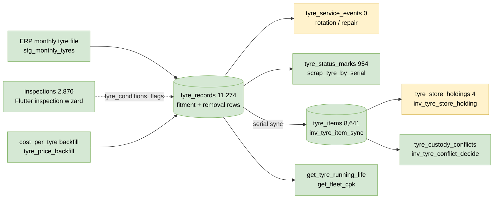

# 05 · Tyre lifecycle

**Legend:** green = IMPLEMENTED (live in DB and wired in code) · yellow = PARTIAL (built but unused, empty, or degrades to "not provisioned") · red = BROKEN (evidence below) · purple dashed = PROPOSED (migration file marked `STATUS: NOT APPLIED`, absent from `supabase_migrations.schema_migrations`) · dashed arrow = text join with no FK, or a proposed link. Row counts are exact `count(*)` reads on 2026-11-24.

Editable: `diagrams/05-tyre-lifecycle/05-tyre-lifecycle.drawio`.

| Stage | Tables / functions | Rows | Status |
|---|---|---:|---|
| Load | `stg_monthly_tyres` → `tyre_records` (staging trigger pipe) | — | IMPLEMENTED |
| Record | `tyre_records` with triggers `trg_guard_tyre_active_fitment`, `trg_zz_normalize_brand`, `trg_apply_tyre_learned_facts`, `trg_zz_one_price_per_tyre`, `trg_ev_tyre_installed`, `z_approval_tyre_execution` | 11,274 | IMPLEMENTED |
| Inspect | `inspections` (2,870) flags via `src/lib/inspectionTyreFlags.js`; joined to tyres by asset + position text, no FK | 2,870 | IMPLEMENTED |
| Service events | `tyre_service_events` | 0 | PARTIAL |
| Scrap | `tyre_status_marks`, `scrap_tyre_by_serial`, `trg_zz_inv_tyre_scrap_flag` | 954 | IMPLEMENTED |
| Warehouse item | `tyre_items` (`tyre_items_item_id_fkey` → material_master, `..._location_id_fkey`), `tyre_item_events`, `inv_tyre_item_sync` | 8,641 | IMPLEMENTED |
| Store holding | `tyre_store_holdings`, `inv_tyre_store_holding` | 4 | PARTIAL |
| Custody conflict | `tyre_custody_conflicts`, `inv_tyre_conflict_investigate/propose/decide/close` | — | IMPLEMENTED |
| Price / CPK | `tyre_price_backfill`, `get_tyre_running_life`, `get_fleet_cpk` | — | IMPLEMENTED |

`tyre_records` has no FK to `vehicle_fleet` or `work_orders`: `asset_no` and `job_card` are text joins.
