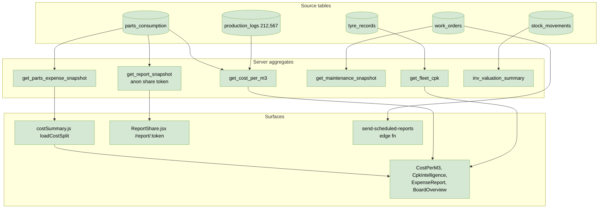

# 06 · Analytics and reporting data flows

**Legend:** green = IMPLEMENTED (live in DB and wired in code) · yellow = PARTIAL (built but unused, empty, or degrades to "not provisioned") · red = BROKEN (evidence below) · purple dashed = PROPOSED (migration file marked `STATUS: NOT APPLIED`, absent from `supabase_migrations.schema_migrations`) · dashed arrow = text join with no FK, or a proposed link. Row counts are exact `count(*)` reads on 2026-11-24.

Editable: `diagrams/06-analytics-reporting/06-analytics-reporting.drawio`.

| Flow | Code | Status |
|---|---|---|
| Expense split tyre / spare / oil | `get_parts_expense_snapshot` → `src/lib/api/costSummary.js` `loadCostSplit` → Dashboard, Analytics, BoardOverview, CostCenter | IMPLEMENTED |
| Cost per m3 | `get_cost_per_m3` over `parts_consumption` + `production_logs` (212,567) → `src/pages/CostPerM3.jsx` | IMPLEMENTED |
| CPK | `get_fleet_cpk` over `tyre_records` → `src/pages/CpkIntelligence.jsx` | IMPLEMENTED |
| Maintenance snapshot | `get_maintenance_snapshot` over `work_orders` | IMPLEMENTED |
| Inventory valuation | `inv_valuation_summary` over the ledger → `ValuationPanels.jsx` | IMPLEMENTED |
| Public / TV boards | `get_report_snapshot` (anon, token) → `src/pages/ReportShare.jsx` | IMPLEMENTED |
| Scheduled email | `report_schedules` → pg_cron → `supabase/functions/send-scheduled-reports` | IMPLEMENTED |
