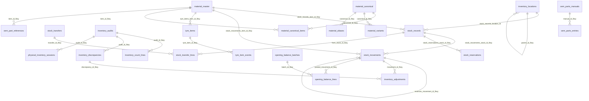
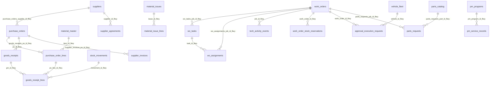

# 07 · PostgreSQL entity relationships (split by domain)

Only foreign keys that exist in the live database (`pg_constraint`, 2026-11-24) are drawn. Relationship labels are the real constraint names. Every table has an `organisation_id` FK to `organisations`; those edges are omitted for readability.

## 07a · Inventory ledger, material and OEM

Editable: `diagrams/07a-erd-inventory/07a-erd-inventory.drawio`.

## 07b · Procurement and workshop

Editable: `diagrams/07b-erd-procurement-workshop/07b-erd-procurement-workshop.drawio`.

## Important relationships that are NOT foreign keys (text joins)

| From | To | Join column | Risk |
|---|---|---|---|
| `parts_consumption` (219,918) | `material_master` | `item_code` text | A code typo silently drops a line from material views |
| `parts_consumption`, `work_order_line_items` | `work_orders` | `work_order_no` text | |
| `work_orders`, `tyre_records`, `inspections` | `vehicle_fleet` | `asset_no` text (+ country) | Same code exists in several countries |
| `material_issues` | `work_orders` | job card number text | |
| `requisitions` | anything | no FKs at all | |

## Proposed tables (not in the live schema)
`procurement_rfqs`, `procurement_rfq_lines`, `procurement_rfq_invites`, `procurement_quotes`, `procurement_quote_lines`, `supplier_returns`, `supplier_return_lines` (`20261124130000`); `job_material_installations` (`20261124131000`); `material_link_proposals` (`20261124132000`); `inventory_scrap_requests`, `inventory_lubricant_dispenses`, `inventory_unit_events`, `equipment_calibrations`, `equipment_custody` (`20261124133000`). Not drawn as live entities.
