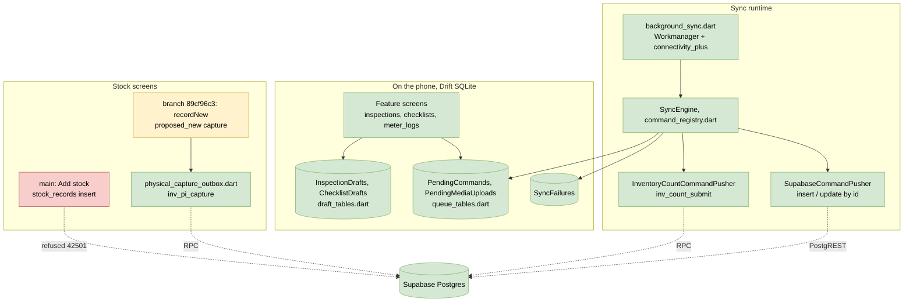

# 08 · Flutter mobile and offline synchronisation

**Legend:** green = IMPLEMENTED (live in DB and wired in code) · yellow = PARTIAL (built but unused, empty, or degrades to "not provisioned") · red = BROKEN (evidence below) · purple dashed = PROPOSED (migration file marked `STATUS: NOT APPLIED`, absent from `supabase_migrations.schema_migrations`) · dashed arrow = text join with no FK, or a proposed link. Row counts are exact `count(*)` reads on 2026-11-24. Here yellow means *fixed on this branch but not merged*.

Editable: `diagrams/08-flutter-offline-sync/08-flutter-offline-sync.drawio`.

| Piece | File | Status |
|---|---|---|
| Local store | `core/database/tables/queue_tables.dart` (`PendingCommands`, `PendingMediaUploads`, `SyncFailures`), `draft_tables.dart` | IMPLEMENTED |
| Command allow-lists | `core/sync/command_registry.dart` (`CommandType`: tyreChange, workOrder, rca, reportIssue, stockAdjust, ...) | IMPLEMENTED |
| Engine | `core/sync/sync_engine.dart` (sync lock via `QueueDao.acquireSyncLock`) | IMPLEMENTED |
| Background | `core/sync/background_sync.dart` (Workmanager periodic + connectivity_plus trigger) | IMPLEMENTED |
| Generic pusher | `core/sync/supabase_command_pusher.dart` (insert / update by id) | IMPLEMENTED |
| Count pusher | `core/sync/inventory_count_command_pusher.dart` → `inv_count_submit` | IMPLEMENTED |
| Physical capture | `features/inventory/data/physical_capture_outbox.dart` → `inv_pi_capture`, `inv_pi_photo_attach` | IMPLEMENTED |
| Stock count "Add stock" | **origin/main**: `stock_count_repository.dart` `create()` inserts `stock_records` with `stock_qty` > 0 (line ~210) and then inserts `stock_movements` directly | **BROKEN** — `inv_balance_guard` raises 42501 on any non-zero insert |
| Stock count "Add stock" | **this branch, commit `89cf96c3`** (not on any remote): `create()` removed; `StockCountRecorder.recordNew` records a `proposed_new` capture via `inv_pi_capture` | PARTIAL (fix not merged, no build) |
| +/- adjust | `post_stock_movement` RPC, online only | IMPLEMENTED |
