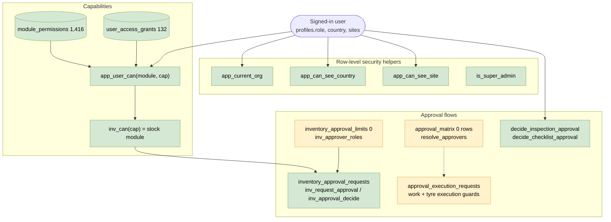

# 09 · Role-based access and approvals

**Legend:** green = IMPLEMENTED (live in DB and wired in code) · yellow = PARTIAL (built but unused, empty, or degrades to "not provisioned") · red = BROKEN (evidence below) · purple dashed = PROPOSED (migration file marked `STATUS: NOT APPLIED`, absent from `supabase_migrations.schema_migrations`) · dashed arrow = text join with no FK, or a proposed link. Row counts are exact `count(*)` reads on 2026-11-24.

Editable: `diagrams/09-rbac-approvals/09-rbac-approvals.drawio`.

| Layer | Objects | Evidence |
|---|---|---|
| Tenant wall | RESTRICTIVE `*_org_isolation` policies on `organisation_id = app_current_org()` | live function `app_current_org` |
| Country / site | `app_can_see_country`, `app_can_see_site` (+ zero-arg scope readers, V396) | live |
| Platform owner | `is_super_admin()` | live |
| Module capabilities | `module_permissions` (1,416), `user_access_grants` (132) → `app_user_can(module, cap)` | client mirror `src/contexts/AuthContext.jsx`, `src/lib/permissionMatrix.js`; console `src/console/pages/access/AccessManager.jsx`; Flutter `core/permissions/access_resolver.dart` |
| Inventory gate | `inv_can(p_cap)` = `app_user_can('stock', p_cap)` (SECURITY DEFINER) used by `inv_*` RPCs | `pg_get_functiondef('inv_can')` |
| Inventory approvals | `inventory_approval_requests` (1), `inventory_approval_decisions`, `inv_request_approval`, `inv_approval_decide`, `inv_approver_roles`; `inventory_approval_limits` 0 rows | `src/components/inventory/ApprovalsPanel.jsx` |
| Generic matrix | `approval_matrix` 0 rows, `resolve_approvers` | `src/lib/api/approvalMatrix.js` — PARTIAL (no rules) |
| Execution guards | `approval_execution_requests` (0), triggers `z_approval_work_start`, `z_approval_tyre_execution` | PARTIAL |
| Document sign-off | `decide_inspection_approval`, `decide_checklist_approval` | IMPLEMENTED |
| Route guards (UI only) | `RoleRoute`, `ModuleRoute` in `src/components/ProtectedRoute.jsx` | hiding is not security; RLS is the boundary |
