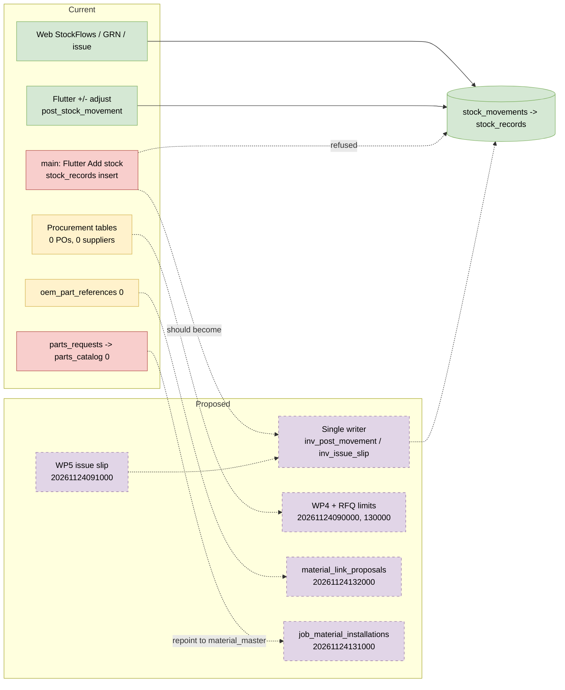

# 10 · Current architecture vs proposed corrected architecture

**Legend:** green = IMPLEMENTED (live in DB and wired in code) · yellow = PARTIAL (built but unused, empty, or degrades to "not provisioned") · red = BROKEN (evidence below) · purple dashed = PROPOSED (migration file marked `STATUS: NOT APPLIED`, absent from `supabase_migrations.schema_migrations`) · dashed arrow = text join with no FK, or a proposed link. Row counts are exact `count(*)` reads on 2026-11-24.

Editable: `diagrams/10-current-vs-proposed/10-current-vs-proposed.drawio`.

## Current (verified)
1. One stock write path: `inv_post_movement` / `post_stock_movement` / `inv_receive_goods` / `inv_issue` → `stock_movements` → `stock_records` (guarded).
2. **BROKEN:** shipped Flutter "Add stock" (origin/main) bypasses it and is refused.
3. **BROKEN:** `parts_requests.part_id` → `parts_catalog` (0 rows); parts are mastered in `material_master`.
4. **PARTIAL:** procurement chain built, 0 suppliers / requisitions / POs; `oem_part_references` 0 rows.
5. **PROPOSED code shipped ahead of the DB:** web services on this branch already call RPCs that only exist in unapplied migrations (`inv_rfq_*`, `inv_confirm_installation`, `inv_material_link_candidates`, `inv_issue_slip`, `inv_scrap_*`); they degrade to "not provisioned".

## Proposed (files written, none applied)

| Migration | Adds | Depends on |
|---|---|---|
| `20261124090000_wms_wp4_procurement_controls.sql` | `guard_po_rules`, `guard_requisition_rules`, `guard_po_delivery_status` | — |
| `20261124091000_wms_wp5_transfer_scope_issue_slip.sql` | `inv_issue_slip`, issue line guards | — |
| `20261124120000_fleet_maintenance_priority.sql` | `fleet_priority_for` | — |
| `20261124130000_wms_procurement_rfq_limits_returns.sql` | RFQ, quotes, supplier returns, PO limits | WP4 |
| `20261124131000_wms_workshop_job_materials.sql` | `job_material_installations`, `inv_confirm_installation` | — |
| `20261124132000_wms_oem_material_link_reconcile.sql` | `material_link_proposals`, `inv_material_link_*` | — |
| `20261124133000_wms_special_classes_locations.sql` | scrap requests, lubricant, calibration, unit events | — |

Not proposed by any file yet (gap): repointing `parts_requests.part_id` to `material_master`; FKs for the text joins listed in diagram 07.
