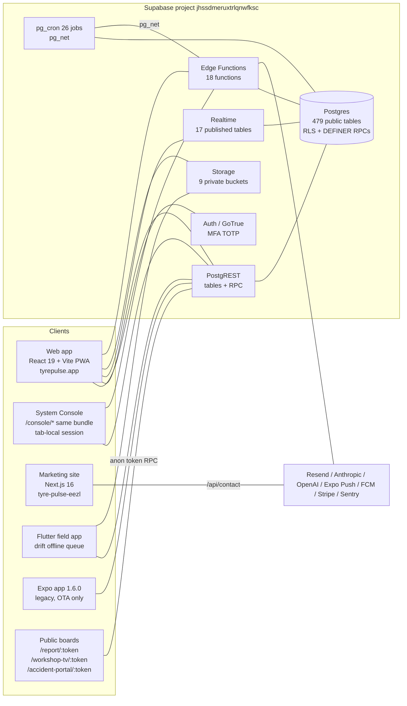

# 01 - Current System Architecture

| Field | Value |
|---|---|
| Deliverable | 1 of 29 |
| Date | 2026-11-10 |
| Status | Built (as-is description). The platform runs in production; this document describes it, it does not propose a rebuild. |
| Evidence | Verified in code: `src/App.jsx`, `src/lib/supabase.js`, `src/console/components/ConsoleLayout.jsx`, `vite.config.js`, `vercel.json`, `.github/workflows/*`, `tyre_pulse_flutter/pubspec.yaml`, `supabase/functions/*`, `services/*`. Verified live (read-only SQL, 2026-11-10): table/function/cron/bucket/publication counts. Taken from PROJECT_MEMORY: Vercel project mapping, Play track, Expo OTA rules, measured performance figures. |
| Related docs | [02 Module inventory](02-module-inventory.md), [10 Data model](10-data-model-recommendations.md), `docs/ARCHITECTURE_CURRENT_STATE.md` (STALE, see section 9), `docs/TARGET_ARCHITECTURE.md`, `docs/flutter-migration/`, `docs/EDGE_FUNCTION_PRODUCTION_MATRIX_2026-08-30.md` |

## 1. Executive summary

Tyre Pulse is a multi-tenant fleet, tyre and maintenance platform made of:

| Surface | Technology | Where | Status |
|---|---|---|---|
| Web application (main app) | React 19 + Vite 8 SPA, prompt-mode PWA | `src/` | Production, Vercel project `tyre-pulse` |
| System Console (platform owner) | Same Vite bundle, routes under `/console/*`, own auth provider | `src/console/` | Production, super-admin only |
| Marketing site | Next.js 16 (App Router) | `marketing/` | Production, Vercel project `tyre-pulse-eezl` |
| Field app (current) | Flutter (Riverpod 3, go_router 18, drift, supabase_flutter) | `tyre_pulse_flutter/` | Play Closed testing (`alpha`), package `com.shahzebrahman.tyrepulse`, version `0.1.1+7` |
| Field app (legacy, live on phones) | Expo SDK 54 / React Native 0.81 | `mobile/` | Store builds RETIRED; binary 1.6.0 still installed; JS-only OTA hotfix path only |
| Native Kotlin app | Kotlin / Compose | `tyre_pulse_app/` | RETIRED (`build-native-android.yml` exits 1) |
| Backend | Supabase: Postgres + RLS, PostgREST, RPCs, Auth, Storage, Realtime, Edge Functions (Deno), pg_cron, pg_net | `supabase/`, root `MIGRATIONS_V*.sql` | Production, project `jhssdmeruxtrlqnwfksc` |
| Optional services | Report engine (Node + Playwright PDF), Analytics (Python FastAPI) | `services/report-engine`, `services/analytics` | Code + CI tests present; production deployment NOT verified |
| Monitoring | Sentry (web, mobile, Flutter), PostHog (web, key likely unset) | `src/lib/monitoring.js`, `src/lib/analytics.js` | Sentry live; PostHog received 0 events per project memory |

The defining characteristic is unchanged since June 2026: **there is no application API tier**. Every client talks directly to Supabase (PostgREST tables, RPC functions, Storage, Auth). The tenant, country and site boundary is enforced in Postgres (RLS policies plus in-body guards in SECURITY DEFINER functions). Edge functions exist for privileged side effects (AI, email, push, billing, exports, sign-in).

## 2. Component diagram



## 3. Hosting and delivery

| Item | Fact | Source |
|---|---|---|
| Web production | Vercel project `tyre-pulse` (`prj_5csYUyBoIN8RFDnHLX8sdO46uZYT`), team `team_Y0LVromY4EL05QQkXQvb55uN`. Deploys on push to `main` via Vercel git and also `.github/workflows/vercel-production.yml` (CLI build + prebuilt deploy, IDs pinned and checked). | workflow file, project memory |
| Build skip | `vercel.json` `ignoreCommand` runs `scripts/vercel-ignore-build.mjs`; pushes touching only `mobile/`, `marketing/`, `*.md`, `MIGRATIONS_*.sql`, `store-assets/`, `.claude/`, `.github/`, Flutter/native dirs skip the web build. Working branches are listed in `git.deploymentEnabled: false` so they raise no preview. | `vercel.json`, project memory |
| Marketing | Vercel project `tyre-pulse-eezl`, Root Directory `marketing`. No custom domain yet; `tyrepulse.app` and `www` both serve the APP. | project memory 2026-09-24 |
| Flutter | `flutter-release-play.yml` (manual) publishes ONLY to Play Closed testing (`alpha`) of `com.shahzebrahman.tyrepulse`; guard fails any other track/package. `flutter-release-ios.yml` archives unsigned. | workflows, project memory |
| Expo | `release-play.yml`, `build-android.yml`, `submit-android.yml` retired (exit 1). `eas-update.yml` re-enabled for OTA hotfixes cut from commit `6c27046` only. | workflows, project memory 2026-10-12 |
| CI | `ci.yml` (web lint + tests + build, mobile tsc + jest, analytics pytest, report engine), `flutter-ci.yml` (analyze, test, goldens, Android/iOS builds), CodeQL. | `.github/workflows/` |
| Standing rule | No mobile builds unless the owner asks. Flutter only for any new build. | project memory |

## 4. Data access model (client to Postgres)

```
Client (supabase-js / supabase_flutter, user JWT)
   |
   +-- PostgREST table read/write ---- RLS: RESTRICTIVE org isolation (organisation_id = app_current_org())
   |                                    + RESTRICTIVE country isolation (V114/V226/V542/V574/V578)
   |                                    + RESTRICTIVE site isolation (V269)
   |                                    + PERMISSIVE role / capability policies (app_user_can, V229/V238/V241)
   |
   +-- RPC (SECURITY INVOKER) -------- RLS applies inside the function
   |
   +-- RPC (SECURITY DEFINER) -------- RLS does NOT apply (owner has BYPASSRLS, V580 finding);
   |                                    each function re-checks org, country and site in its body
   |                                    (V545 to V573 guard sweep). 734 of 1,147 public functions are DEFINER.
   |
   +-- Edge function (Deno) ---------- validates JWT itself (verify_jwt=false on self-validating functions so
                                        CORS-wrapped errors stay readable), uses service role for privileged writes
```

Key helpers (all in Postgres): `app_current_org()`, `app_country_scope()`, `app_site_scope()`, `app_sees_all_countries()`, `app_can_see_country()`, `app_can_see_site()`, `is_super_admin()`, `app_is_elevated()`, `app_user_can(module, capability)`. The zero-argument scope readers are wrapped as `(select ...)` so they run once per query (V396 cut work_orders reads from ~12 s to ~0.14 s, measured 2026-07-27 per project memory).

Paging rule: PostgREST caps every response at 1,000 rows. All register reads use `src/lib/fetchAll.js` (`fetchAllPages`, page 0 alone then windows of 4) or server aggregates. `src/test/rowCapGuard.test.js` fails CI on a new unbounded read of a large table.

## 5. Authentication surfaces

| Surface | Session storage | Rules | Code |
|---|---|---|---|
| Main web app | `localStorage` key `tp_auth` | Username or email sign-in (`get_email_by_identifier` RPC for synthetic `@users.tyrepulse.app` accounts; real-email accounts use edge fn `sign-in`); approval gate; MFA assurance gate (`src/lib/authAssurance.js` refuses AAL1 sessions with unmet MFA); login lockout V287; idle sign-out from `system_config.session_timeout_hours` | `src/contexts/AuthContext.jsx`, `src/pages/Login.jsx` |
| System Console | `sessionStorage` key `tp_console_auth` (tab-local, cleared on tab close) | Only when the tab BOOTS on `/console`; super-admin only; 10 min idle and 8 h absolute cap; main app shows NO console link (owner rule 2026-08-05); `ConsoleSurfaceGate` blocks same-tab navigation into the console | `src/lib/supabase.js` (`IS_CONSOLE_SURFACE`, `AUTH_STORAGE_KEY`), `src/console/ConsoleAuthContext.jsx`, `src/App.jsx` |
| Flutter | `flutter_secure_storage` | Same sign-in RPC + `sign-in` edge fn; offline cached profile; forced update via `system_config.flutter_min_version` | `tyre_pulse_flutter/lib/features/auth`, `core/auth` |
| Expo (legacy) | Chunked SecureStore with generation keys | Session-restore timeout 8 s; AppState-driven token refresh; 90-day offline profile cache | `mobile/contexts/AuthContext.tsx` |
| Anonymous boards | none | Token rows (`report_shares`) validated by DEFINER RPCs `get_report_snapshot`, `get_workshop_snapshot`, `get_accident_portal_snapshot`; anon has NO table grants (V281) and only a 10-function EXECUTE allowlist (V500) | `src/pages/ReportShare.jsx`, `WorkshopTv.jsx`, `AccidentPortalView.jsx` |
| QR sign-in | Phone approves a browser login with number matching | Feature flag `qr_login_enabled` OFF until a Flutter build ships | edge fn `qr-login` |

## 6. Offline and queued writes

| Client | Mechanism | Idempotency | Notes |
|---|---|---|---|
| Flutter | drift (SQLite) command queue: `core/sync/command_registry.dart`, `queued_command_repository.dart`, `sync_engine.dart`, `background_sync.dart` | `client_uuid` columns on target tables (V81, V125, V215, V292) | Workforce transitions have their own durable queue (project memory 2026-10-25). Flutter photos synced offline are stored as local paths on some paths (known gap, project memory 2026-10-05). |
| Expo | `mobile/lib/offlineQueue.ts` (inspections) + `mobile/lib/recordQueue.ts` (generic commands) on SecureStore | `client_uuid` upserts | Read-modify-write refuses when the storage read failed (data-loss fix). New storage format is NOT rollback safe. |
| Web | `src/lib/offlineQueue.js` + Workbox NetworkOnly background-sync queue for writes | `client_uuid` | Prompt-mode service worker, `skipWaiting: false`, `clientsClaim: false` so a deploy never yanks an open tab. |

## 7. Backend inventory (live, read-only, 2026-11-10)

| Object | Count / list |
|---|---|
| Public tables / views | 479 / 20 |
| Public functions / SECURITY DEFINER | 1,147 / 734 |
| Partitioned tables in `public` | 0 |
| Generated columns | 10 (`tyre_records.fitment_date`, `work_orders.total_cost`, `parts_consumption.erp_bucket`, `pm_service_records.total_cost`, ...) |
| Organisations / profiles | 5 / 769 |
| Active pg_cron jobs | 26 (scheduled reports every 15 min, domain events and workflow notifications every minute, nightly backup 00:30, audit retention 01:15, upload-gap check 05:30, security audit weekly, AI tyre inspection worker every 5 min, ...) |
| Storage buckets | 9, all private: inspection-photos, tyre-photos, accident-photos, vehicle-photos, import-files, driver-fine-evidence, tenant-exports, workforce-evidence, team-action-evidence |
| Realtime publication | 17 tables (pruned by V582 because the WAL decoder was the largest DB cost) |
| Edge functions (repo) | 18: account-recovery, admin-revoke-sessions, ai-orchestrator, ai-tyre-inspection, billing-checkout, billing-webhook, chat-ai, embed-worker, generate-embedding, public-api, qr-login, send-email, send-scheduled-reports, sentry-crash-alert, sentry-issues, sign-in, tenant-export, workflow-notify |
| Migrations | 576 root `MIGRATIONS_V*.sql` (older, V-numbered) + 241 timestamped files in `supabase/migrations/` (newer). Next free = any timestamp after `20261111090000`. |

Largest tables (live): `audit_log_v2` 578,281 rows / 654 MB; `parts_consumption` 220,425; `production_logs` 212,567; `domain_events` 222,611; `work_orders` 96,554; `work_order_line_items` ~184,025; staging `ksa_country_upload_template_staging` ~282,352. `shared_buffers` is 256 MB (project memory 2026-08-17), so the audit table alone is larger than the cache.

## 8. Cross-cutting services in the web client

| Concern | Single source | Notes |
|---|---|---|
| Error text to users | `src/lib/safeError.js` (`toUserMessage`), `src/lib/api/_client.js` `unwrap()` | Raw Postgres text never reaches UI; ErrorBoundary shows a reference id |
| Access | `src/lib/accessResolver.js`, `src/lib/permissionMatrix.js`, `src/lib/navAccess.js`, `AuthContext.hasPermission/hasCapability` | Matches server `app_user_can` precedence |
| Cost | `src/lib/governedCost.js` (no scalar cross-currency total), `src/lib/api/costSummary.js`, `src/lib/costSources.js` | Expense grid (`parts_consumption`) is the authoritative cost source |
| KPIs | `src/lib/kpiEngine.js` + server RPCs (`get_fleet_cpk`, `get_cost_cpk_overview`, ...) | Lifetime CPK is not yet end-to-end server side (project memory 2026-11-09) |
| Config | `src/lib/api/systemConfig.js` | Reads `system_config`; `ENFORCEMENT_STATUS` says which switches are really enforced |
| Exports | `src/lib/exportUtils.js`, `src/lib/pdfEngine.js` (`loadAutoTable`) | jspdf 4 + autotable via prototype fallback |
| Monitoring | `src/lib/monitoring.js` (Sentry, lazy) + `system_logs` sink | Errors also land in `system_logs` |

## 9. Corrections to `docs/ARCHITECTURE_CURRENT_STATE.md` (dated 2026-06-29)

| Stale statement | Current fact |
|---|---|
| "React Native 0.81.5 / Expo SDK 54 field mobile app" | Flutter (`tyre_pulse_flutter/`) is the field app for all new builds. Expo 1.6.0 remains installed in production and receives JS-only OTA hotfixes only. |
| "Database: 46 tables" | 479 public tables, 20 views (live 2026-11-10). |
| "Edge Functions: chat-ai, send-email, generate-embedding" | 18 functions (section 7). |
| "69 files call supabase directly" | Calls go through `src/lib/api/*` (368 entries) plus a minority of page-level calls; the service layer is the convention. |
| No mention of console | `/console/*` is a separate tab-local admin surface with 5 areas. |
| Go backend migration as next step | No Go service exists in the repo. `docs/GO_BACKEND_MIGRATION_PLAN.md` is a plan only. |
| `src/lib/queryClient.js` / TanStack Query as state layer | TanStack Query is installed but no page uses `useQuery` (project memory 2026-07-27); pages load via services + local state. |

These corrections are recorded here; the old file is left untouched (brief rule: edit only `docs/enterprise-pack/`).

## 10. Known architectural weaknesses

| # | Weakness | Impact | Phase | Effort |
|---|---|---|---|---|
| 1 | No API tier; schema is the contract | Every column rename is a client release; RLS + DEFINER guards are the only boundary | 4 | XL |
| 2 | 734 DEFINER functions each re-implement org/country/site checks | One missed guard leaks data (8 holes found and closed 2026-08-16/17) | 2 | L (guard generator + test) |
| 3 | `audit_log_v2` 2.5x the shared buffer cache; 94.5% of rows from bulk imports | IO-bound DB; slow audit reads | 2 | M |
| 4 | Two field apps live at once (Expo binary + Flutter testing) | Two offline queues, two registries to keep in sync (drift test exists) | 3 | M |
| 5 | Optional report/analytics services not deployed (unverified) | Server PDF and Python forecasting unavailable; client fallback in use | 4 | M |
| 6 | PostHog receives nothing | No product analytics for adoption | 1 | S |
| 7 | Marketing has no custom domain | Branded host serves the app | 1 | S (owner action) |

## Open decisions for the owner

- Whether to deploy `services/report-engine` and `services/analytics` (needs a host and `VITE_REPORT_SERVICE_URL`).
- Domain move: app to `app.tyrepulse.app`, marketing to `www`/root (owner action in Vercel).
- When to promote the Flutter app beyond Closed testing and stop Expo OTA support.
- Whether bulk imports should stop writing `audit_log_v2` rows (changes the audit contract).
- Set `VITE_POSTHOG_KEY` / host in Vercel or remove PostHog.

## Next actions

| Action | Phase | Effort |
|---|---|---|
| Replace `docs/ARCHITECTURE_CURRENT_STATE.md` content with a pointer to this document | 1 | S |
| Add a CI check that every new SECURITY DEFINER function contains an org guard (catalog test against live DB or migration lint) | 2 | M |
| Decide and act on PostHog key and marketing domain | 1 | S |
| Archive/partition plan for `audit_log_v2` and `domain_events` (see doc 10) | 2 | M |
| Retire Expo OTA path once Flutter is on production track | 3 | S |
