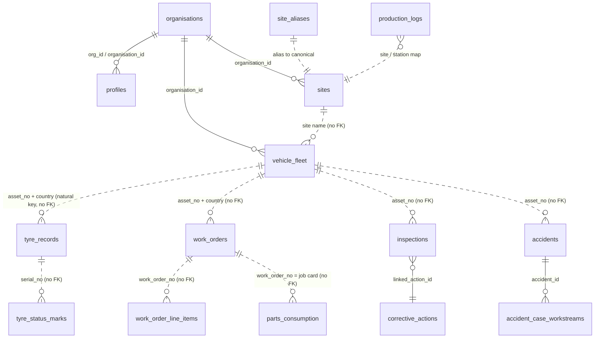

# 10 - Data Model Recommendations

| Field | Value |
|---|---|
| Deliverable | 10 of 29 |
| Date | 2026-11-10 |
| Status | Partly built. Tenant/country/site keys, RLS, normalisation triggers, import idempotency and hot-path indexes are Built. Referential integrity between core entities, a tyre identity key, archiving and partitioning are Not built. |
| Evidence | Verified live (read-only SQL, 2026-11-10): table counts, exact row counts, unique indexes, foreign keys on core tables, generated columns, `org_id` vs `organisation_id` distribution, partitions (none in `public`), oldest audit/event rows, `system_config` retention values. Verified in code: `src/lib/api/_client.js`, `src/lib/tyreKm.js`, `src/lib/tyreLifetime.js`, `src/lib/workOrderStatus.js`. Rules and past measurements taken from PROJECT_MEMORY (dated in text). |
| Related docs | [01 Architecture](01-current-system-architecture.md), [03 Duplicates](03-duplicate-module-report.md), `docs/DATA_DICTIONARY.md`, `docs/DATA_MODEL_CONSOLIDATION_PLAN.md`, `docs/tyre/BUSINESS_RULES.md`, `docs/tyre/CALCULATION_SOURCE_MAP.md`, `docs/IMPORT_CENTER_DATA_MODEL.md` |

## 1. Scale today

| Measure | Value (live 2026-11-10) |
|---|---|
| Public tables / views / functions | 479 / 20 / 1,147 (734 SECURITY DEFINER) |
| Tables with `organisation_id` / `org_id` / `country` / `site` | 372 / 8 / 275 / 155 |
| Organisations / profiles | 5 / 769 |
| Largest | `audit_log_v2` 578,281 rows (654 MB, oldest row 2026-07-03); `domain_events` 222,611 (oldest 2026-07-08); `parts_consumption` 220,425; `production_logs` 212,567; `work_orders` 96,554; `work_order_line_items` ~184,025; `tyre_records` 11,410; `vehicle_fleet` 1,622 |
| Staging tables | 39 (`stg_*`, per-country `stg_*_ksa|uae|egypt`, `expenses_ksa|uae|egypt`, `erp_*_import`, `*_country_upload_template_staging`) |
| Rollback snapshot tables | many in `_bak` schema plus a few in `public` (e.g. `_bucket_snapshot_20260727` 216,792 rows, `_wo_country_snapshot_v394`) |

## 2. Core entities and relationships

Solid lines are real foreign keys; dotted lines are natural-key joins with NO foreign key (verified: `tyre_records`, `work_orders`, `vehicle_fleet` carry FKs only to `organisations` and `profiles`).

| Entity | Table | Identity | Notes |
|---|---|---|---|
| Tenant | `organisations` | `id` | 5 rows; only one holds operational data (project memory) |
| User | `profiles` | `id` = `auth.users.id` | Role (Title Case, validated by `normalize_profiles_role`, custom roles allowed V282), `country text[]`, `sites text[]` ('ALL' sentinel, V309), `is_super_admin` |
| Site | `sites` | `(organisation_id, country, name)` | Region recorded once here (`sites.region`); every other table carries the site NAME only; aliases in `site_aliases` (54) |
| Asset | `vehicle_fleet` | UNIQUE `(organisation_id, country, asset_no)` | Same `asset_no` in two countries is usually a DIFFERENT machine (V376). `status` (Active/Inactive register) is separate from `ops_status` (running/breakdown/idle, V539) |
| Tyre fitment | `tyre_records` | `id`; no natural unique key | `serial_no` is NOT unique (DOT batch codes, sizes in serial column); fitment key used by imports = serial + asset + position + issue_date (V349/V513); one active tyre per wheel guarded by trigger `guard_tyre_active_fitment` |
| Job card | `work_orders` | UNIQUE `work_order_no` (global) | Prefix encodes country 1:1 (AFKR/GCKR = KSA, RM = UAE, EG = Egypt). Canonical statuses via `src/lib/workOrderStatus.js`, CHECK widened to union (V497) |
| Expense line | `parts_consumption` | partial UNIQUE `(organisation_id, import_uid)` | THE cost source. `import_uid` = md5(country, source_row, business key, store, cost centre); 89,999 rows have NULL uid (UAE/Egypt files lacked the `#` line column) so only the file fingerprint protects them |
| Production | `production_logs` | `dn_number` per upload | Approved m3 is the cost-per-m3 denominator (V523); dedupe by `dn_number` + content (V516) |
| Inspection | `inspections` | `id`, `document_no` | Approval and lock columns; content locked after approval (`trg_lock_inspection_content`) |
| Accident case | `accidents` | `reference_no` | Claims embedded on the row; workstreams in `accident_case_workstreams`; stage ledger `accident_stage_events` |
| Audit | `audit_log_v2` | `id` | Tenant key `org_id`; immutable (`prevent_audit_mutation`); `actor_type` since V499 |

## 3. Multi-tenant keys

| Key | Rule | Enforcement |
|---|---|---|
| Tenant | `organisation_id = app_current_org()` | RESTRICTIVE `*_org_isolation` policies; column default `app_current_org()`; BEFORE INSERT stamp for service-role imports (V290); NOT NULL on 10 import targets (V315) |
| Country | Row `country` within `app_country_scope()`; NULL row country visible to all in scope | RESTRICTIVE country policies (V114, V226, V542 read+write, V574, V578); DEFINER functions guard in body (V545 to V573) |
| Site | Row `site` within `app_site_scope()`; blank scope = no access, `ALL` = org-wide | RESTRICTIVE SELECT policies on 21 tables (V269), write scope V542; DEFINER named-site path guarded (V553), all-sites path closed (V554 to V557) |
| Super-admin | `is_super_admin()` only crosses orgs | V306 removed plain-Admin cross-org bypass; V498/V558 removed it from country |

Split to resolve: `org_id` is the tenant column on `alert_thresholds`, `audit_log_v2`, `module_permissions`, `module_permissions_archive`, `report_schedules`, `tenant_export_jobs`, `user_access_grants`; everything else uses `organisation_id`. `profiles` has both, kept equal by trigger `tr_sync_profile_org` (V311). `app_current_org()` reads `profiles.org_id`.

## 4. Data integrity mechanisms already present

| Mechanism | Where |
|---|---|
| Normalisation triggers | `normalize_vehicle_type` (V245), `trg_zz_normalize_site` + `site_aliases` (V246/V247/V524), asset_no upper + no whitespace (V337/V490), brand canonical `trg_zz_normalize_brand` (V588/V589), removal reason (V590). Trigger names with `zz_` must sort last (load-bearing). |
| Import idempotency | `client_uuid` unique on field-captured tables; `import_uid` on expenses; file `sha256` fingerprint (V363); staging triggers return NULL (pure pipes) |
| Guards | expense country guard by job-card prefix (V491), UAE building guard (V603), one active tyre per wheel, last-admin guard (V308), privileged profile guard (V307) |
| Generated columns | 10, e.g. `tyre_records.fitment_date`, `work_orders.total_cost` (labour + parts only), `parts_consumption.erp_bucket`, `pm_service_records.total_cost`. Rule: never include generated columns in INSERT ... SELECT (V320 lesson); restore functions build explicit column lists |
| Generated-column trap | Never add a generated column to `inspections` or `checklist_submissions` (BEFORE-trigger diff guards break, project memory 2026-10-11) |
| Calculation mirrors | `src/lib/tyreKm.js` mirrors SQL `tyre_km_life`; `src/lib/classificationBrain.js` mirrors `classify_parts_consumption`; `src/lib/accidentCase.js` mirrors `docs/accident-module/08_ENGINE_SQL_MIRROR.sql`. Change both sides together |

## 5. Recommendations

| # | Recommendation | Why | Phase | Effort | Risk |
|---|---|---|---|---|---|
| R1 | Retire `fleet_master` (0 rows) after repointing its 4 readers to `vehicle_fleet` | Live defect (doc 03 D1) | 1 | S | Low |
| R2 | Add `asset_id uuid` (nullable) to `tyre_records`, `work_orders`, `inspections`, `accidents`, `parts_consumption`; backfill by `(organisation_id, country, asset_no)` from `vehicle_fleet`; keep `asset_no` for display and imports | Natural-key joins break on renames and cross-country collisions (V376); FK enables cascade-safe history and fast joins | 2 | L | Medium (backfill on 220k rows; disable classify trigger during backfill, V373 lesson) |
| R3 | Add a `tyre_id` (physical tyre) table keyed by `(organisation_id, normalised serial, brand)` with weak-serial handling (`tyre_serial_is_strong`) | Serial is not unique; lifetime CPK and scrap need one tyre identity | 3 | L | Medium |
| R4 | Converge `org_id` to `organisation_id` on the 7 tables (add column, backfill, dual-write trigger, switch policies, drop later) | One tenant key for RLS generators and tests | 3 | M | Medium (audit_log_v2 is immutable: add column via trigger-stamped default only for new rows, keep `org_id` readable) |
| R5 | Partition `audit_log_v2` and `domain_events` by month (range on `created_at`) using a new partitioned table + swap | Largest tables; retention by `DROP PARTITION` instead of DELETE; audit table is 2.5x the 256 MB cache | 2 | L | Medium (audit immutability trigger must be re-attached; ACCESS EXCLUSIVE swap needs a window) |
| R6 | Stop or summarise bulk-import audit rows (V499 `app.bulk_import` lever) | 94.5% of audit rows came from 8 import days (measured 2026-08-17) | 2 | S | Owner decision (audit contract) |
| R7 | Archive staging tables after promotion: move `*_country_upload_template_staging` (282k + 39k + 16k rows) older than 90 days to an `archive` schema or export to storage | Staging is 2nd largest by size, not read by reports | 2 | M | Low |
| R8 | Move rollback snapshots (`_bucket_snapshot_20260727`, `_wo_country_snapshot_v394`, other `_bak.*`) to cold storage after 90 days with a register of what each restores | Snapshots grow unbounded; some are in `public` | 1 | S | Low |
| R9 | Composite indexes must lead with `country` (or the filtered column), not `organisation_id` | RLS org predicate is `org = app_current_org() OR is_super_admin()`, which cannot drive an index (measured 2026-10-11) | ongoing | S | Low |
| R10 | Every new read RPC with nullable filters gets `SET plan_cache_mode = force_custom_plan` | Generic plans lost index use (measured 3.1 s to 0.2 s, 2026-10-11) | ongoing | S | Low |
| R11 | Make lifetime CPK a server function family (one price per tyre, lifetime km) and retire per-row CPK RPCs | Two calculation grains (doc 03 D19) | 2 | L | High (numbers change) |
| R12 | Require the `#` line-number column on every expense import (refuse files without it) or derive a stable line key | 89,999 expense rows cannot be deduplicated on re-import | 1 | S | Low |
| R13 | Add NOT NULL `country` on country-scoped business tables where all rows have it (work_orders has 1 NULL row left) | NULL country is visible to every country scope by design | 2 | S | Low |
| R14 | FX: populate `currency_rates` (0 rows) with entered + approved rates (V380 workflow) before any cross-currency total | All combined totals are refused today, by design | 1 | S | Owner action |
| R15 | Data dictionary generated from catalog comments + `metric_registry` (12 KPIs) | `docs/DATA_DICTIONARY.md` is manual and stale | 2 | M | Low |
| R16 | Drop or fill tables of modules that will never be used (doc 02 section 7) only after a release with them OFF | 78 nav items over empty tables | 3 | M | Low |

## 6. Archiving and retention (current vs proposed)

| Data | Current | Proposed |
|---|---|---|
| `audit_log_v2` | `audit_retention_days` = 365 (cron `audit-log-retention` 01:15 deletes only log rows); 0 rows old enough yet | Monthly partitions (R5); keep 12 months hot, export older to `tenant-exports` bucket as signed NDJSON |
| `system_logs`, `access_audit` | Same retention job | Unchanged |
| Business data | `data_retention_months` = 24 is SAVED ONLY by decision; business records are never auto-deleted (owner decision 2026-07-19) | Keep decision; archive by export, not delete |
| `cron.job_run_details` | 30-day purge job `cron-run-history-retention` (2026-10-11) | Unchanged |
| `domain_events` | No retention | Partition + 180-day hot window once consumers are confirmed idempotent |
| Staging | Retained | R7 |

## 7. Partitioning candidates

| Table | Rows | Key | Benefit | Priority |
|---|---|---|---|---|
| `audit_log_v2` | 578k | `created_at` month | Retention, cache pressure | 1 |
| `domain_events` | 223k | `created_at` month | Retention | 2 |
| `parts_consumption` | 220k | `country` list then `event_date` year | Country-scoped scans; only when > ~5M rows | 3 (not yet) |
| `production_logs` | 213k | `period_date` year | Year filters | 3 (not yet) |
| `work_orders` | 97k | none yet | - | not needed |

Partitioning below a few million rows gives little query benefit here; the measured wins came from RLS initplan wrapping (V396, ~85x), custom plans and country-leading indexes. Partition for retention, not speed.

## Open decisions for the owner

- R6: keep auditing bulk imports row by row, or log one summary row per import.
- R14: who enters and approves FX rates.
- R2/R3: approve adding surrogate asset and tyre identities (multi-week backfill, no user-visible change).
- V579 audit-log country attribution (hides 39,979 rows from KSA-scoped admins, project memory 2026-08-17) is still pending.

## Next actions

| Action | Phase | Effort |
|---|---|---|
| R1, R8, R12 | 1 | S |
| R5 design + rehearsal on a branch database | 2 | L |
| R2 asset_id backfill plan with `database-migration-safety` checklist | 2 | L |
| R4 tenant key convergence plan | 3 | M |
| R11 lifetime CPK server functions (pairs with doc 04 D19) | 2 | L |
